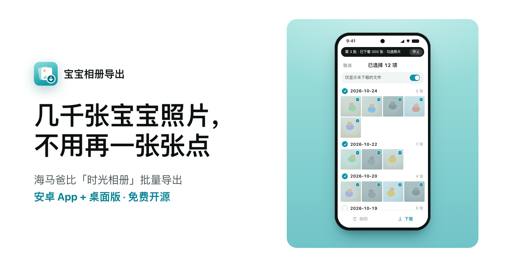

<p align="center"></p>

<h1 align="center">宝宝相册导出</h1>

<p align="center">把海马爸比「时光相册」里的几千张照片，批量保存到手机或电脑。<br>自动勾选、自动下载、逐张校验。非官方开源工具。</p>

<p align="center">
  <a href="https://hanqing.github.io/babyalbum-export/">网站</a> ·
  <a href="https://github.com/Hanqing/babyalbum-export/releases/latest">下载</a> ·
  <a href="docs/实施记录.md">实施记录</a> ·
  <a href="https://github.com/Hanqing/babyalbum-export/issues">问题反馈</a>
</p>



## 为什么做这个

海马爸比的时光相册保存在云端。官方 App 支持批量下载，但要在「精彩瞬间」里按日期一组组勾选，再点“下载”。实测的账号有 2,515 张照片，分布在 448 天里，手动导出就要勾选 448 次日期，还要反复翻页、等待、确认。小红书上也有家长吐槽要一张张点。

这个项目替你完成这些点击：在官方 App 里自动勾选“未下载”的照片，点“下载”，一批接一批，直到列表清空。

## 两个版本

|  | 安卓 App（宝宝相册导出） | 桌面版（相册导出助手） |
| --- | --- | --- |
| 照片存到 | 手机相册「海马爸比」文件夹 | 电脑上的归档文件夹 |
| 需要 | 安卓 8.0+，开启无障碍服务 | macOS 或 Windows，Python 3.9+，adb，手机打开 USB 调试 |
| 全量 2,515 张实测 | 约 11 分钟 | 20 分 44 秒 |
| 怎么核对 | 统计相册里新增的照片数 | 每张核对 SHA-256、大小和 JPEG 结构 |
| 另外 | 安装包 33 KB，不联网 | 按月份整理、写入拍摄时间、导出报告 |

两个版本都：只下载“未下载”的照片；中断后接着下；从不点“删除”；遇到不认识的页面就暂停；照片不上传。

## 快速开始

### 安卓 App

1. 在 [Releases](https://github.com/Hanqing/babyalbum-export/releases/latest) 下载 `babyalbum-export.apk` 并安装。手机提示“来源不明”或“有风险”时，确认继续安装。
2. 打开「宝宝相册导出」，点“去开启”，在无障碍设置里打开它。如果开关是灰色的（Android 13 及以上），先到「应用详情 → 右上角菜单 → 允许受限设置」。
3. （可选）允许读取相册，用来核对每批是否真的下载成功。
4. 点“开始导出”。保持亮屏、不要操作手机；顶部黑条显示进度，可以随时停止。vivo 等手机第一次会问是否允许打开海马爸比，请选“始终打开”。

照片由海马爸比 App 自己存进 `DCIM/Camera/海马爸比`。要存到电脑，可以用数据线复制这个文件夹，或者用桌面版。

### 桌面版

1. 手机：设置 → 关于手机 → 连续点“版本号”7 次；在开发者选项里打开“USB 调试”，连上电脑后在手机上点“允许”。
2. 电脑：安装 Python 3.9+ 和 adb。Mac 可以用 `brew install android-platform-tools`；也可以下载 Google 的 [platform-tools](https://developer.android.com/tools/releases/platform-tools)，解压到 `desktop/platform-tools/`。
3. 下载 [album-export-desktop.zip](https://github.com/Hanqing/babyalbum-export/releases/latest/download/album-export-desktop.zip) 并解压。Mac 双击「相册导出助手.command」（第一次需要右键 → 打开），Windows 双击「相册导出助手.bat」，在打开的网页里点“开始导出”。

也可以用命令行：

```bash
cd desktop
python3 -m album_export doctor                                    # 检查连接、手机状态、App 版本
python3 -m album_export export  --dest ~/Pictures/海马爸比相册归档   # 导出并逐张校验
python3 -m album_export archive --dest ~/Pictures/海马爸比相册归档   # 生成按月份、写入拍摄时间的副本
```

归档目录里，`原始文件/` 是官方 App 下载的原文件（原名、原字节），`按月份/` 是写入了拍摄时间的副本，`导出报告.md` 记录搬运完整性、来源覆盖和限制。更多参数见 [desktop/README.md](desktop/README.md)。

## 工作原理

```
打开海马爸比 → 设备页 → 时光相册 → 全部照片 →「精彩瞬间」
  → 打开“仅显示未下载的文件”，进入编辑
  → 回到列表顶部，按日期整组勾选约 150 张 → 点“下载”
  → 等文件落盘（桌面版：拉到电脑，逐张校验后入库）
  → 等列表刷新，重复，直到显示“暂无内容”
```

- **桌面版**：Python 标准库 + adb。用 `uiautomator dump` 读界面、`input` 点击；每张照片核对手机端 SHA-256、大小和 JPEG 结构，全部通过才原子地放进归档；SQLite 账本记录进度。
- **安卓 App**：AccessibilityService 读取界面并点击，只接收海马爸比 App 的事件。构建不依赖 Gradle。
- **进度以文件为准**：海马爸比判断“已下载”的依据，是 `DCIM/Camera/海马爸比` 里有没有同名文件。所以中断后再开始，会从还没下载的照片接着来。

## 安全规则

- 只点导航白名单里的控件和日期勾选框；文字含“删除”等词的控件一律不点。
- 勾选框必须完整位于标题栏和底部操作栏之间才点。“下载”和“删除”紧挨着：桌面版只点“下载”远离“删除”的一侧，并先核对两个按钮的文字和 ID；App 直接调用“下载”按钮自身的点击动作。
- 不认识的页面、锁屏、断线、连续没有进展都会暂停，再次运行从断点继续。
- 不删除、不移动手机上的任何照片；不联网、不上传。

## 实测数据

测试机：vivo V2133A，Android 14，海马爸比 3.4.2。方法：先把手机上的 2,515 张照片临时挪走（记录 SHA-256），让它们重新变成“未下载”；跑完后逐张核对重新下载的文件与原文件逐字节一致，再放回原处。

| 版本 | 全量用时 | 勾选 | 下载 | 批次 | 结果 |
| --- | --- | --- | --- | --- | --- |
| 原型脚本（2026-10-24） | 68.5 分钟 | — | — | 143 | 2,514 张 |
| 桌面版 | 20 分 44 秒 | 961 秒 | 168 秒 | 13 | 2,515 张，失败 0 |
| 安卓 App | 约 11 分钟 | 427 秒 | 130 秒 | 13 | 2,515 张，失败 0 |

慢在勾选，不在下载：桌面版每读一次界面约 3 秒（共 228 次），App 读界面几乎不花时间。下载本身 200 张约 10 秒。

## 照片与拍摄时间

- 下载得到的是官方 App 提供的 JPG（实测 2560×1440），不带 EXIF。同一张照片重复下载，文件逐字节相同；还没有和摄像头里的源文件比对过，所以不声称等同摄像头原图。
- 文件名是拍摄时刻的 Unix 时间戳，`_NGT` 表示夜间红外照；摄像头按东八区计时。桌面版的「按月份」副本按 +08:00 写入拍摄时间（DateTimeOriginal 与 OffsetTimeOriginal），原始文件保持不变。

## 兼容性与限制

- 已验证：海马爸比 3.4.2，vivo V2133A，Android 14，macOS。
- 未验证：Windows 实机（会自动查找 adb，部分手机需要装厂商 USB 驱动）、其他品牌手机、海马爸比的其他版本。遇到不认识的页面会暂停，不会乱点。
- 不支持：iPhone；纯血鸿蒙（不能运行安卓 App，也没有 adb）。
- 海马爸比在电脑和手机上同时登录会互相踢下线，所以桌面版通过数据线操作手机上已经登录的 App。
- 导出期间官方 App 要停留在前台，手机要亮屏、解锁。
- 安卓 App 目前是调试签名的测试版；以后换正式签名时，需要先卸载旧版再安装。

## 项目结构

```
android-app/   安卓独立 App（Java，AccessibilityService；build.sh 不依赖 Gradle）
desktop/       桌面版（Python 标准库 + adb；命令行和浏览器图形界面）
  tests/       单元测试，含脱敏后的真机界面样本
  tools/       test_queue.py：在手机上造“未下载”队列，测完逐张核对复原
docs/          方案评估与实施记录
site/          项目网站（GitHub Pages，推送到 main 后自动部署）
```

## 开发

```bash
# 桌面版单元测试
cd desktop && python3 -m unittest discover -s tests

# 构建 APK（需要 Android SDK build-tools 和 JDK 17+）
cd android-app && ./build.sh              # 输出 build/babyalbum-export.apk

# 本地预览网站
python3 -m http.server 8000 --directory site
```

`desktop/tools/test_queue.py` 会把最新的 N 张照片临时挪到手机的 Download 目录，造一个真实的待下载队列；测完只在重新下载的文件与原文件哈希一致时才删除临时副本。细节见 [desktop/README.md](desktop/README.md) 和 [android-app/README.md](android-app/README.md)。

## 文档

- [方案评估](docs/haimababi-export-product-assessment.md)：各条技术路线的比较和取舍。
- [实施记录](docs/实施记录.md)：实测到的 App 行为、踩过的坑、全量基准。

## 免责声明

本项目是独立的开源工具，与海马爸比及其开发商没有关联。“海马爸比”是其权利人的商标，这里只用来说明适用的 App。工具只在官方 App 里替你点击“勾选”和“下载”，请用它导出你自己账号里的照片。

## 许可

[MIT](LICENSE)
